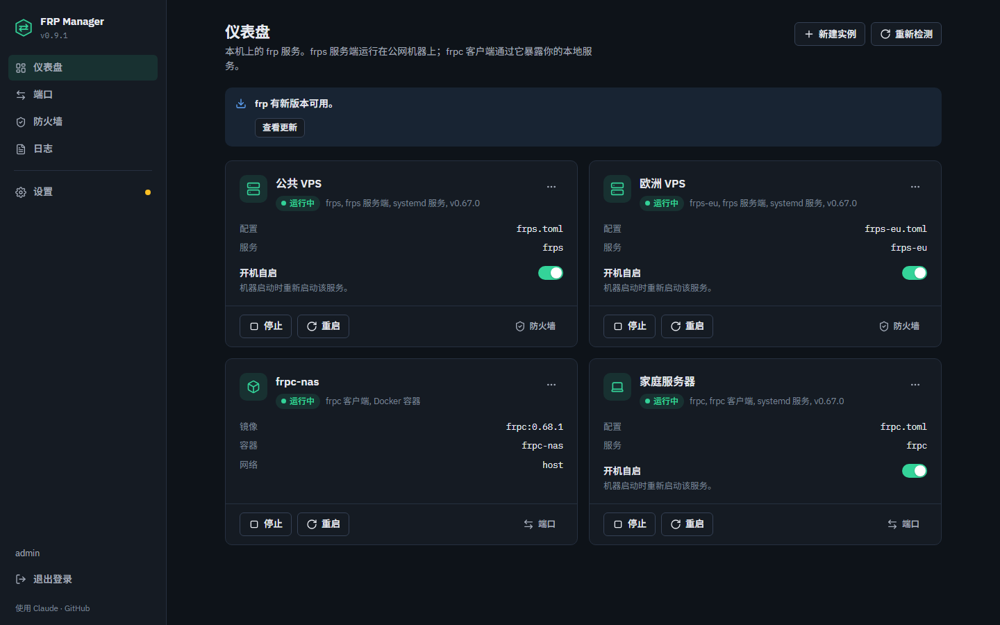
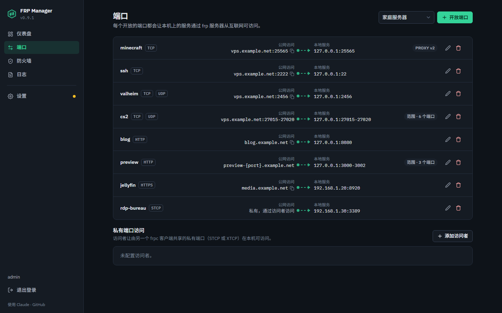
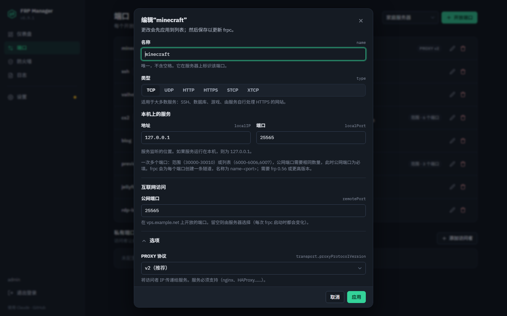
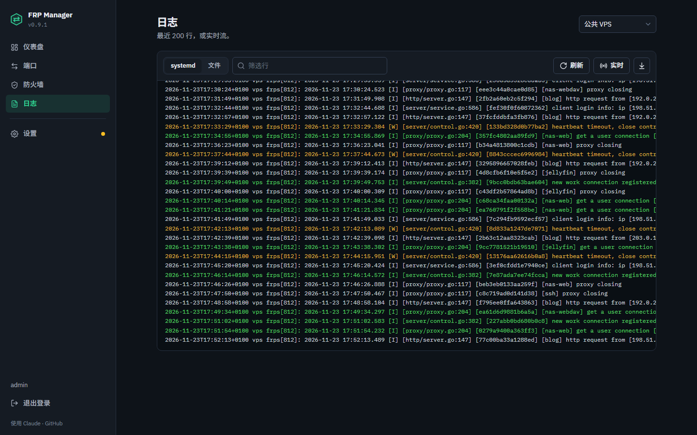
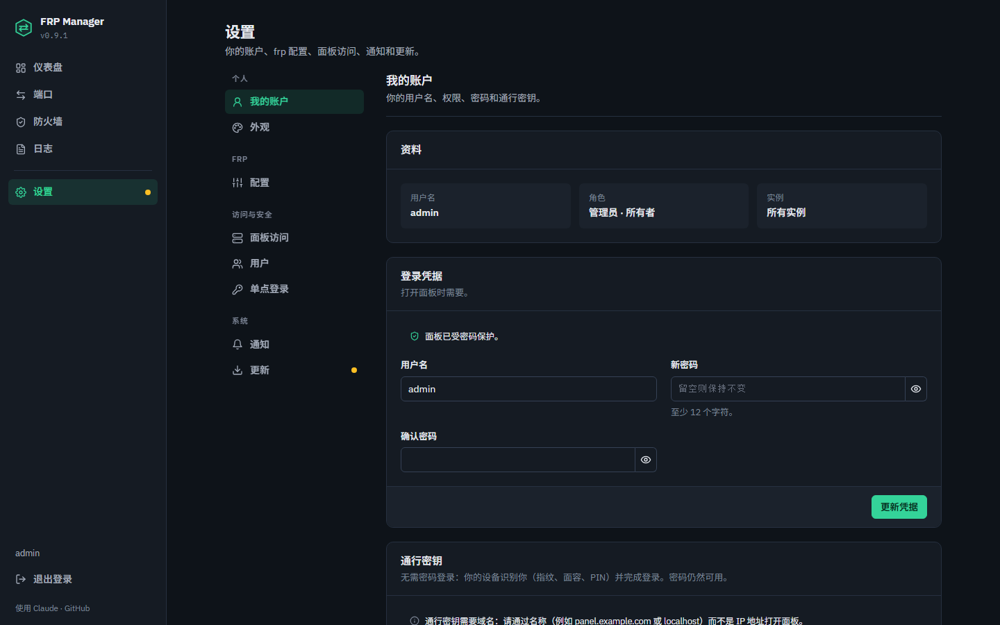

# FRP Manager

[frp](https://github.com/fatedier/frp) 的自托管 Web 界面和仪表盘：在浏览器中管理 **frps** 和 **frpc**，不必再编辑 TOML 文件、重启 systemd 服务或通过 SSH 查看日志。

[](LICENSE)
[](https://github.com/Gogowwww/frp-manager/releases)

[](https://github.com/users/Gogowwww/packages/container/package/frp-manager)
[](https://frp-manager.org/zh/)
[](https://score.getplumber.io/github.com/Gogowwww/frp-manager)

[English](README.md) · [Français](README.fr.md) · **简体中文**



## 快速开始

使用 Docker Compose：镜像包含 frps 和 frpc，面板会自行启动它们（独立模式，无需在机器上安装其他东西）：

```bash
curl -O https://raw.githubusercontent.com/Gogowwww/frp-manager/main/docker-compose.yml
docker compose up -d
```

面板只监听 `127.0.0.1:8765`。在你的电脑上建立 SSH 隧道 `ssh -L 8765:127.0.0.1:8765 user@server`，然后打开 `https://127.0.0.1:8765` 并创建管理员账户。如果要从局域网访问，请参阅[从另一台机器访问面板](https://frp-manager.org/zh/docs/installation/)。

不使用 Docker 时，安装脚本会配置面板（单个程序，无额外依赖）、frp 及其 systemd 服务：

```bash
curl -LO https://github.com/Gogowwww/frp-manager/releases/latest/download/frp-manager.zip
unzip frp-manager.zip && cd frp-manager && sudo bash install.sh
```

添加 FRP Manager 的软件源后，也可以使用 apt：`sudo apt install frp-manager`，之后用 `apt upgrade` 更新；请参阅[使用 apt 安装](https://frp-manager.org/zh/docs/installation/)。

还没准备安装？[在线演示](https://frp-manager.org/demo/?lang=zh)使用示例数据运行真实界面。

## 功能

- **仪表盘**：自动检测 frps/frpc 的 systemd 服务、二进制文件、配置和 Docker 容器；使用 Docker 时，也可以由面板自行启动 frps 和 frpc。支持启动、停止、重启、开机自启，通过 WebSocket 显示实时状态，设置昵称，一键重装已删除的 frps/frpc 服务。
- **端口（frpc）**：可读的列表（`vps.example.net:25565 → 127.0.0.1:25565`），以及针对 `tcp`、`udp`、`http`、`https`、`stcp`、`xtcp` 和访问者的向导式编辑器。支持 PROXY 协议、加密和压缩，同一端口同时用于 TCP 和 UDP，以及[端口范围](https://frp-manager.org/zh/docs/installation/)（`30000-30010`）。编辑器不处理的设置会保持不变。未指定编号的端口会由服务器分配公网端口；确认后，面板可以通过 frpc 的本地仪表盘显示它（参见 [SECURITY](.github/SECURITY.md)）。
- **防火墙（frps）**：按地址、网络或整个提供商（AS 号）设置仅允许或阻止规则，在内核中通过 nftables 于 Docker NAT 之前生效；实时显示被阻止的连接；可选社区列表。
- **配置**：按区块显示 frps 和 frpc 设置，每个字段都标注对应的 TOML 键；写入前会先解析配置。
- **日志**：systemd 日志、日志文件、面板启动的 frps/frpc 输出，或 Docker 容器日志，通过 WebSocket（SSE 回退）实时显示，并支持过滤。
- **通知**：通过 Webhook 向 Discord、Slack、Telegram、ntfy、Gotify 或任意 URL（JSON 模板、HMAC 签名）发送通知，用于实例停止、地址被锁定和更新。
- **更新**：一键安装 frp 并校验 SHA-256，手动上传归档，一键更新面板。
- **用户与权限**：支持多个账户，每个账户可设置角色（管理员、操作员、查看者）或自定义权限，也可以限制为只能管理某些实例；更改立即生效，包括已打开的会话。
- **单点登录**：OpenID Connect（Keycloak、Authentik、Authelia、Zitadel、Google、Microsoft Entra 等），支持通过电子邮件预建账户或在首次登录时创建账户，并从提供商的用户组获取角色。
- **通行密钥**：无需密码，使用手机、电脑或安全密钥（指纹、面容、PIN）登录；每个账户可添加多个通行密钥。
- **界面**：浅色和深色主题，支持桌面和移动端，提供英语、法语和简体中文（根据浏览器语言选择，可在“设置”中更改）。

| 端口 | 端口编辑器 |
|:---:|:---:|
|  |  |
| **实时日志** | **设置** |
|  |  |

## 为什么选择这个面板

frp 是通过 TOML 文件配置的单个二进制文件。手动运行没有问题，但日常管理仍然是手工操作：每新增一个端口都要通过 SSH 编辑文件、重启对应的服务、检查端口是否已被占用、找到正确的日志。FRP Manager 保留这种模式，并在其上增加一层管理界面：

| 任务 | 手动使用 frp | FRP Manager |
|---|---|---|
| 新增或修改隧道 | 编辑 `frpc.toml`，重启 frpc | 向导式表单，保存前校验 TOML，一键保存并重启 |
| 查看暴露了哪些服务 | 阅读配置文件 | 按客户端列出端口及其访问路径 |
| 多个 frps/frpc 实例 | 每个实例都要跟踪一个服务和一份文件 | 自动检测，每个实例一张卡片；可从仪表盘创建新实例并自动分配空闲端口 |
| 过滤谁能访问 frps 端口 | 编写 nftables 或 iptables 规则 | 按 IP、网络或 AS 设置规则，应用前先测试 |
| 查看日志 | 通过 SSH 运行 `journalctl -fu frpc` | 在浏览器中查看实时日志 |
| 更新 frp | 下载、校验、替换二进制文件、重启 | 一键完成，校验 SHA-256，重启服务 |

面板不会取代 frp，也不会改变其配置格式：文件仍然是纯 TOML，你仍然可以手动编辑；移除面板后，frp 会像以前一样继续运行。

## 安全

面板控制对外暴露的端口并以 root 身份运行，因此默认已经做了严格限制：

- **强制初始设置**：在创建管理员账户之前，任何页面或 API 路由都不会响应（密码至少 12 个字符）。
- **密码哈希**：使用 argon2id；旧哈希（scrypt、SHA-256）可接受一次，之后会自动重新哈希。
- **新安装只监听 `127.0.0.1`**；对外开放需要明确选择。
- **暴力破解防护**：按 IP 限制尝试次数，并逐步延长锁定时间。
- **最小权限**：每个 API 路由和 WebSocket 都会检查账户权限；管理用户的账户不能授予超过自身的权限，只有完整管理员才能配置单点登录。
- **通行密钥（WebAuthn）**：只有确认密码后才能添加，要求用户验证，通行密钥与面板域名绑定，并校验签名计数器。
- **OpenID Connect**：使用带 PKCE 的授权码流程、`state` 和 `nonce`；校验 ID 令牌的签发者、受众和有效期；账户按提供商和主体关联，或按提供商验证过的电子邮件关联。
- **Web 加固**：每次更改都校验 CSRF 令牌，使用 HttpOnly / SameSite=Strict / Secure Cookie、Content-Security-Policy、X-Frame-Options 和 Referrer-Policy。
- **系统加固**：不会用用户输入拼接 shell 命令；服务和容器名称使用白名单；配置限制在 frp 的目录内；安全解压归档。
- **供应链**：frp 归档和面板更新都会对照发布的 SHA-256 校验；第三方镜像（ghproxy、ghfast、gh-proxy）可以禁用，且没有校验和时绝不使用。

> **Docker 警告**：独立模式（`docker-compose.yml`）只添加 `NET_ADMIN` 能力，用于防火墙：控制面板的人可以修改机器的网络规则。不会挂载主机的任何内容，也没有 `privileged` 模式或 Docker socket。部署前请阅读[安装指南的 Docker 部分](https://frp-manager.org/zh/docs/installation/)。

威胁模型和漏洞报告：[SECURITY.md](.github/SECURITY.md)（英文）。

## 文档

- [项目网站](https://frp-manager.org/zh/)：项目介绍、在线演示和完整文档
- [安装、配置和卸载](https://frp-manager.org/zh/docs/installation/)：系统要求、Docker 镜像及其权限、版本和预发布版本、配置键、端口范围与 TCP + UDP、反向代理、忘记密码、文件结构
- [安全策略](.github/SECURITY.md)（英文）
- [更新日志](https://frp-manager.org/zh/docs/changelog/)

## 贡献

欢迎报告错误、提出想法、参与翻译和提交拉取请求：请参阅 [CONTRIBUTING.md](.github/CONTRIBUTING.md) 和[行为准则](.github/CODE_OF_CONDUCT.md)（英文）。值得阻止的地址可以通过防火墙的 **发布** 按钮或 [`blocklists`](https://github.com/Gogowwww/frp-manager/tree/blocklists) 分支分享。

## 许可证

[Apache 2.0](LICENSE)。

## 致谢

[fatedier/frp](https://github.com/fatedier/frp)，这个面板所围绕的项目。

## 开发

新版本先以预发布形式发布，测试通过后再提升为正式版本。

[](https://www.star-history.com/?repos=Gogowwww%2Ffrp-manager&type=date&legend=bottom-right)
